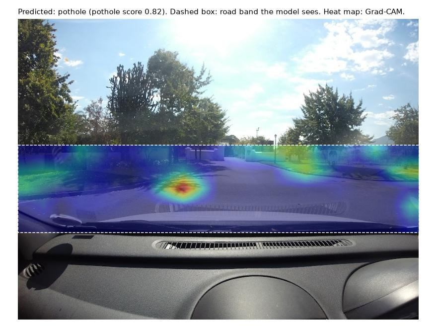
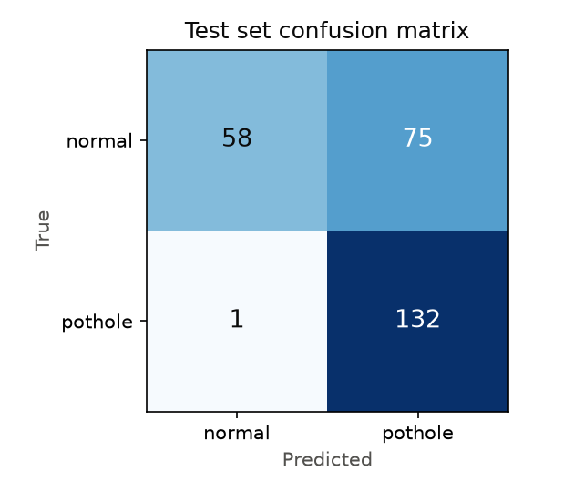
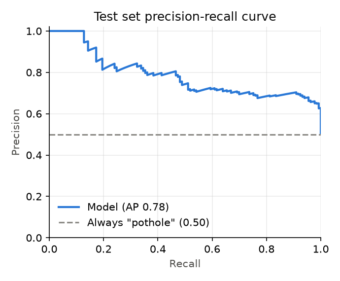
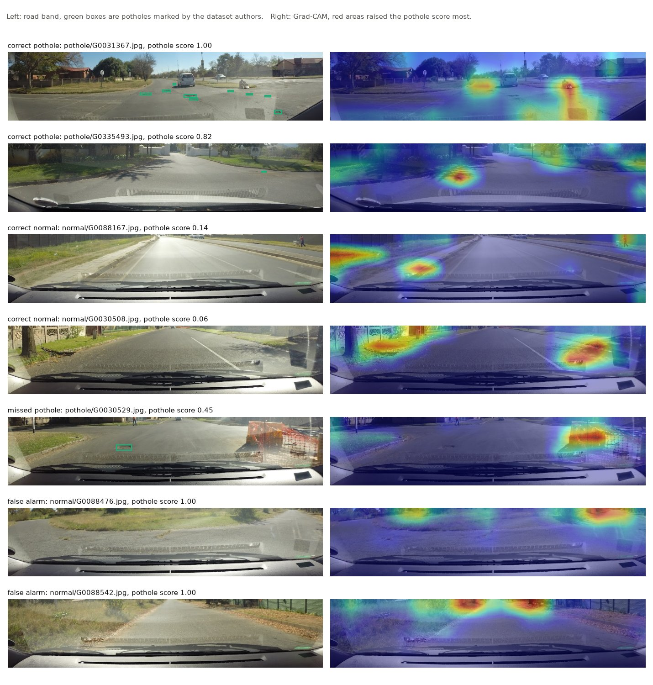

# Pothole Detector

A small image classifier that looks at a dash-camera frame and says whether the road ahead shows a pothole. It is trained and tested on real frames from South African roads, from a public dataset made at Stellenbosch University. It is a starting point for screening dash-cam footage for road maintenance, and a worked example of testing such a model honestly: on recording sessions it never saw in training, against a trivial baseline.



*Output of `python main.py --mode predict` on a test frame from a session the model never saw. The model only looks at the dashed band. It is right that this frame has a pothole, but the heat map (Grad-CAM), which marks the area that raised the score most, sits on a tree shadow and not on the small pothole the dataset marks on the right. That is typical; see the Grad-CAM check below.*

## Results

All numbers below come from `python main.py --mode evaluate` on the test set: 266 frames (133 pothole, 133 normal) from 11 recording sessions that were not used for training or for choosing the model. The decision threshold is 0.5, fixed before testing.

| Model | Accuracy | Precision | Recall | F1 | Average precision |
|---|---|---|---|---|---|
| This model (MobileNetV3-Small) | 0.714 | 0.638 | 0.992 | **0.776** | 0.784 |
| Always say "pothole" | 0.500 | 0.500 | 1.000 | 0.667 | 0.500 |
| Always say "normal" | 0.500 | 0.000 | 0.000 | 0.000 | |

The 95% bootstrap interval for the model's F1 is 0.725 to 0.825, so it beats the best constant guess (F1 0.667), but not by a wide margin. The classes are balanced, so a majority-class guess scores 0.500 accuracy.

The model finds almost every pothole frame (132 of 133) but also raises an alarm on 75 of the 133 normal frames. On these new sessions it scores too many frames as pothole. The precision-recall curve shows that a higher threshold would trade some recall for fewer false alarms; I did not tune it on the test set.

| Confusion matrix | Precision-recall curve |
|---|---|
|  |  |

Example test predictions, including the one missed pothole and the two false alarms with the highest scores. Correct cases were picked at random.



Both false alarms show rough or patched road with no pothole marked, and their heat maps sit far down the road. Several heat maps sit on things beside the road (trees, a wall, a barrier).

### Grad-CAM check: does the model look at the potholes?

For each of the 132 pothole frames the model flags, the evaluate step finds the peak of the Grad-CAM map and checks whether it falls within 40 pixels (about one Grad-CAM cell) of a pothole box marked by the dataset authors. It does in 34 of 132 frames (26%). A point picked at random would land in those zones 12% of the time. So the model looks at potholes more often than chance, but in most frames its strongest evidence is somewhere else in the band. This fits the many false alarms, and it is the main thing to fix.

### Stress test with simple filters

`synthetic_data.py` holds image filters that imitate dust, rain, mud on the lens, harsh sun, shadows and worn paint. The evaluate step runs the same test frames through each filter.

| Filter | Accuracy | Precision | Recall | F1 |
|---|---|---|---|---|
| None | 0.714 | 0.638 | 0.992 | 0.776 |
| Dust | 0.680 | 0.610 | 1.000 | 0.758 |
| Rain | 0.718 | 0.649 | 0.947 | 0.771 |
| Mud | 0.692 | 0.619 | 1.000 | 0.764 |
| Harsh sun | 0.688 | 0.662 | 0.767 | 0.711 |
| Shadows | 0.673 | 0.624 | 0.872 | 0.727 |
| Worn surface | 0.711 | 0.646 | 0.932 | 0.763 |

Harsh sun and shadows hurt most: recall falls to 0.767 and 0.872. These filters are crude drawings made with OpenCV, so this table shows how sensitive the model is to such changes. It says nothing reliable about real dust, rain or mud.

## How it works

1. **Download** (`data.py`). The script lists the authors' Google Drive folders for "Dataset 1 (Simplex), Train data": 1,337 pothole frames and 3,399 frames without potholes. 76 file names sit in both folders; the three pairs I checked are the same image, so all 76 are dropped. It then picks frames so each GoPro recording session gives the same number of pothole and normal frames (602 of each in total), so session lighting or camera angle alone does not tell the classes apart. Frames are fetched at a quarter of full size (920x690) together with the authors' pothole boxes, which are used only for the figures.
2. **Split by session.** GoPro names each frame `G<session><frame>`. Whole sessions go to train (814 frames, sessions 001, 002, 006), validation (124 frames, sessions 004, 005) or test (266 frames, 11 sessions). Frames next to each other in a video look almost the same, so a random split would leak near-copies of test frames into training.
3. **Crop the road.** The model sees only the band of rows from 42% to 71% of the frame height, where the road ahead is, resized to 736x160. The authors' own notes suggest cropping to the road in the same way.
4. **Model** (`model.py`, `train.py`). MobileNetV3-Small with ImageNet weights and a one-output head, fine-tuned with AdamW (learning rate 5e-4, cosine decay) for 6 epochs, with random flips and colour changes. The epoch with the lowest validation loss is kept (epoch 2). Training takes about 85 seconds per epoch on 2 CPU threads.
5. **Evaluate** (`evaluate.py`). Test metrics, the two constant baselines, a bootstrap interval for F1, the figures above, Grad-CAM heat maps (`utils.py`) and the check of where they point, and the filter stress test. Everything is saved to `docs/`, including `docs/results.json`.
6. **Predict** (`infer.py`). Scores one frame and saves a picture like the one at the top.

## How to run it

Python 3.12, CPU only.

```bash
python -m venv .venv
source .venv/bin/activate            # Windows: .venv\Scripts\activate
pip install torch torchvision --index-url https://download.pytorch.org/whl/cpu
pip install -r requirements.txt

python main.py --mode download       # 1,204 frames into data/stellenbosch (about 220 MB)
python main.py --mode train          # writes models/pothole_classifier.pt
python main.py --mode evaluate       # prints the tables above, writes docs/
python main.py --mode predict --image data/stellenbosch/pothole/G0335493.jpg
python -m pytest tests               # split, sampling, parsing, metric and model tests
```

`predict` writes its picture to `predictions/` unless you pass `--out`. Run `python main.py --help` for the other options (backbone, epochs, image width, threshold). Results on another machine may differ a little from the ones above.

The road band assumes a camera mounted like the one in this dataset. Frames from other cameras may need a different band (`ROAD_BAND` in `data.py`).

## Data source and licence

- **Dataset:** pothole image dataset by S. Nienaber, M.J. Booysen and R.S. Kroon, Department of Electrical and Electronic Engineering, Stellenbosch University (2015). Dash-camera frames (GoPro) from South African roads.
- **Source:** https://drive.google.com/drive/folders/1vUmCvdW3-2lMrhsMbXdMWeLcEz__Ocuy (no login needed). Downloaded on 23 October 2026.
- **Licence:** the authors share the data openly and ask users to cite the two papers below; their README names no formal licence. The [Kaggle mirror](https://www.kaggle.com/datasets/sovitrath/road-pothole-images-for-pothole-detection) and [Dataset Ninja](https://datasetninja.com/road-pothole-images) list it as CC0 1.0 (public domain). This repo does not contain the images; the download step fetches them from the authors' folder.
- **Papers:**
  - S. Nienaber, M.J. Booysen, R.S. Kroon, "Detecting potholes using simple image processing techniques and real-world footage", SATC, July 2015, Pretoria, South Africa.
  - S. Nienaber, R.S. Kroon, M.J. Booysen, "A Comparison of Low-Cost Monocular Vision Techniques for Pothole Distance Estimation", IEEE CIVTS, December 2015, Cape Town, South Africa.

## Limits and next steps

- **Yes or no per frame, not boxes.** The model does not say where a pothole is, and its heat map points at a marked pothole in only 26% of flagged frames. The dataset includes pothole boxes, so the next step is to use them: a small object detector scored with mAP, or a classifier on tiles of the road band labelled from the boxes, so the model has to learn the potholes themselves.
- **Too many false alarms on new sessions.** Choosing the threshold on more validation sessions, or training on more sessions, should help. Only three sessions are used for training.
- **Narrow data.** One camera in one part of South Africa. The frames I looked at are all dry daylight scenes on tarred suburban roads; the model has not been tested at night, in rain or on gravel.
- **Small test set.** 266 frames from 11 sessions, and three sessions supply most of them; the F1 interval is about 0.1 wide.
- **Labels come from the dataset authors.** Some "normal" frames show worn or patched road that a person might call damaged.
- **No video or live mode.** The code scores single frames; I have not measured speed.

## Project layout

```
main.py            command line: download, train, evaluate, predict
data.py            download, session-balanced sampling, session split, road crop, dataset
model.py           MobileNetV3-Small or ResNet-18 with a one-output head
train.py           training loop, keeps the best epoch by validation loss
evaluate.py        test metrics, baselines, figures, Grad-CAM check, stress test
infer.py           score one frame and save a picture
utils.py           metrics, bootstrap interval, Grad-CAM, plots
synthetic_data.py  dust, rain, mud, sun, shadow and wear filters for the stress test
tests/             unit tests
docs/              figures and results.json from the run reported above
```

## Author

Tiiso Letsapa, Letsapamyron07@gmail.com

MIT licence, see [LICENSE.txt](LICENSE.txt).
